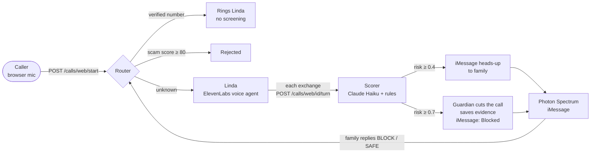

# Guardian

**A call firewall for older adults.** Guardian sits between Linda, 78, and the phone. Family and known
contacts ring straight through. Known scam numbers never ring at all. Everyone else is screened live: Guardian
listens to the call, scores every sentence for scam risk, texts the family the moment something looks wrong,
and cuts the call off itself once it is a scam.

Built at LA Hacks 2026.

## Try the demo

Open the site and click **Call Linda from your browser**. No phone needed: your browser's microphone is the
phone line. Linda (an AI voice) picks up. Try to scam her, for example *"This is the IRS, you owe $2,000 in
back taxes and there's a warrant for your arrest unless you pay with gift cards today."* Watch the risk meter
climb. Guardian cuts the call in its own voice, and Linda's family gets an iMessage.

The phone also lets you call as Linda's son (a verified number that rings straight through) or from a
number already flagged as a scam (rejected before Linda's phone ever rings).

## How a call works



1. **Route.** The backend checks the caller's number: verified numbers pass, numbers with a scam score of
   80 or more are rejected, everyone else is screened.
2. **Listen.** Linda answers. After every sentence the caller finishes, the browser sends the exchange to the
   backend. `ml/scorer.py` gives the whole conversation so far to **Claude Haiku**, which returns a risk score,
   the scam stage (hook, authority, urgency, isolation, payment or info) and short red flags. Keyword rules run
   alongside as a backup, and an obvious scam on the rules alone ends the call without waiting for the model.
3. **Warn.** At risk 0.4 the family gets a one-time iMessage: *"Heads up, Mom is getting a suspicious call
   right now…"*
4. **Cut.** At risk 0.7 Guardian cuts Linda off mid-sentence, plays its own announcement (*"This is Guardian,
   Linda's call protection. I've ended this call because it matches a scam…"*), saves the transcript as
   evidence and texts the family: *"Blocked a likely scam call… Reply BLOCK or SAFE."* A BLOCK reply blocks the
   number for Linda and raises its scam score for every Guardian user; SAFE adds it to her verified list.
5. **Score.** Every number builds a 0–100 scam score (live risk, family flags, call patterns), and Linda gets a
   weekly 0–100 safety score. All weights live in `backend/app/config.py`.

**Privacy.** Every call starts with a recording notice (California requires all-party consent). Analysis stops
at 90 seconds. Only scam calls are kept, for 90 days; every other call's transcript is deleted once it is
decided. Verified callers are never screened or recorded.

## Repository layout

| Path | What it is |
|---|---|
| `backend/` | FastAPI app: call routing, live scoring, event stream for the dashboard, scam and safety scores, evidence, family alerts. Postgres / TimescaleDB (Tiger Cloud). See [`backend/README.md`](backend/README.md). |
| `ml/` | `scorer.py` (the live scorer the backend imports), the 2,500-call labelled transcript dataset (`transcripts.jsonl`, 1,500 scam / 1,000 legit) and the scripts that generated it and prepare it for fine-tuning. |
| `family-messenger/` | Node service on Photon Spectrum that sends the family's iMessages and forwards their BLOCK / SAFE replies to the backend. |
| `web/` | The site (Vite + TypeScript): the landing page (`public/index.html`) and the browser phone (`phone.html`, `src/phone.ts`). |
| `voice/` | Setup notes for the Linda voice agent on ElevenLabs. |
| `Dockerfile`, `railway.json` | One container that runs the backend and the family messenger together (Railway). |
| `backend/deploy/` | Alternative deploy to a plain Ubuntu VM (systemd + Caddy). |
| `CONTRACTS.md` | The team's shared interface spec: endpoints, events, scorer contract, schema, scoring rules. |

## Run it locally

Needs Python 3.13, Node 22 and Docker (for a local database), or a `DATABASE_URL` for Tiger Cloud.

```bash
cp .env.example .env              # fill in the keys below
python3 -m venv .venv && .venv/bin/pip install -r backend/requirements.txt
docker compose -f backend/docker-compose.yml up -d        # skip if DATABASE_URL points at Tiger Cloud
.venv/bin/uvicorn backend.app.main:app --port 8000        # API on :8000

cd family-messenger && npm install && npm start           # iMessage relay on :8787 (needs its own .env)
cd web && npm install && npm run dev                      # site on http://localhost:5173
```

Tests run against the local database and never send texts or call any API:

```bash
.venv/bin/python -m pytest backend/tests -q
```

### Environment

| Variable | Where | Purpose |
|---|---|---|
| `DATABASE_URL` | backend | Postgres / TimescaleDB connection string |
| `ANTHROPIC_API_KEY` | backend | Claude scorer (without it, keyword rules only) |
| `ELEVENLABS_API_KEY`, `ELEVENLABS_AGENT_ID` | backend | Linda's voice agent; the backend hands the browser a signed session URL |
| `TRUSTED_PHONE` | backend | The family member who gets the iMessages |
| `PHOTON_SIDECAR_URL` | backend | Where the family messenger listens (`http://localhost:8787`) |
| `PUBLIC_BASE_URL` | backend | The backend's public URL, used in evidence links |
| `PROJECT_ID`, `PROJECT_SECRET` | `family-messenger/.env` | Photon Spectrum project |
| `VITE_API_BASE` | web (build time) | The backend URL the site calls |
| `ELEVENLABS_WEBHOOK_SECRET` | backend, optional | Post-call webhook, to keep scam call audio |
| `TWILIO_*`, `GUARDIAN_NUMBER` | backend, optional | Real phone numbers and SMS fallback |

## Deploy

- **Backend + messenger → Railway.** Connect the repo; `railway.json` builds the root `Dockerfile`. Add the
  backend variables above plus `PROJECT_ID` / `PROJECT_SECRET`, and generate a domain on the port the logs
  show (8080).
- **Site → Vercel.** Import the repo with Root Directory `web` and set `VITE_API_BASE` to the Railway URL.
- **Photon.** Add the trusted phone number as a project user, or sends are rejected on shared lines.

## Built with

FastAPI · Tiger Data (TimescaleDB) · Claude Haiku (Anthropic API) · ElevenLabs Conversational AI · Photon
Spectrum (iMessage) · Vite · Railway · Vercel

## Team

Tanishi Dutt · Ishan Agrawal · Ananya Mysore
